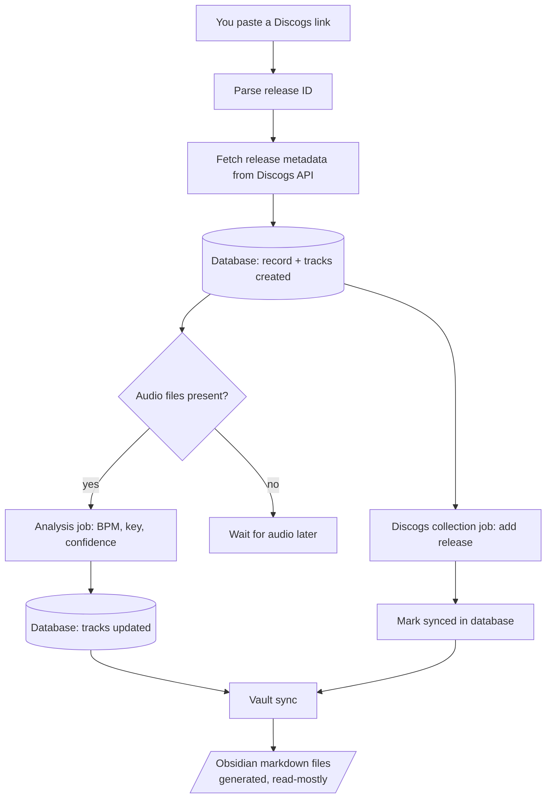
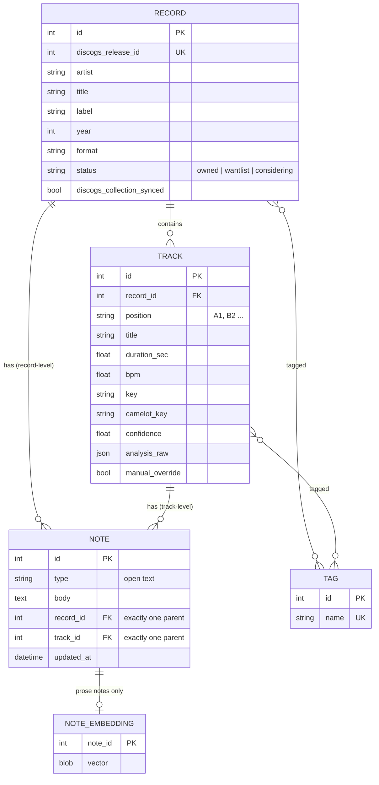
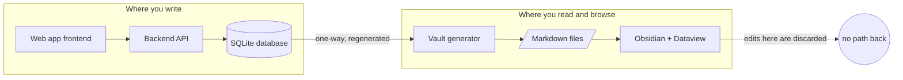
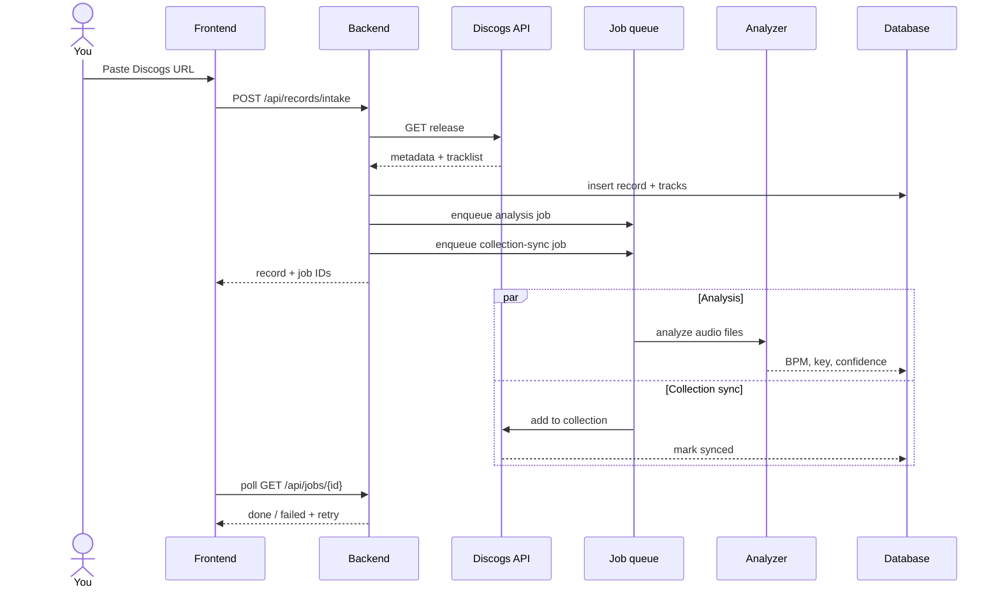
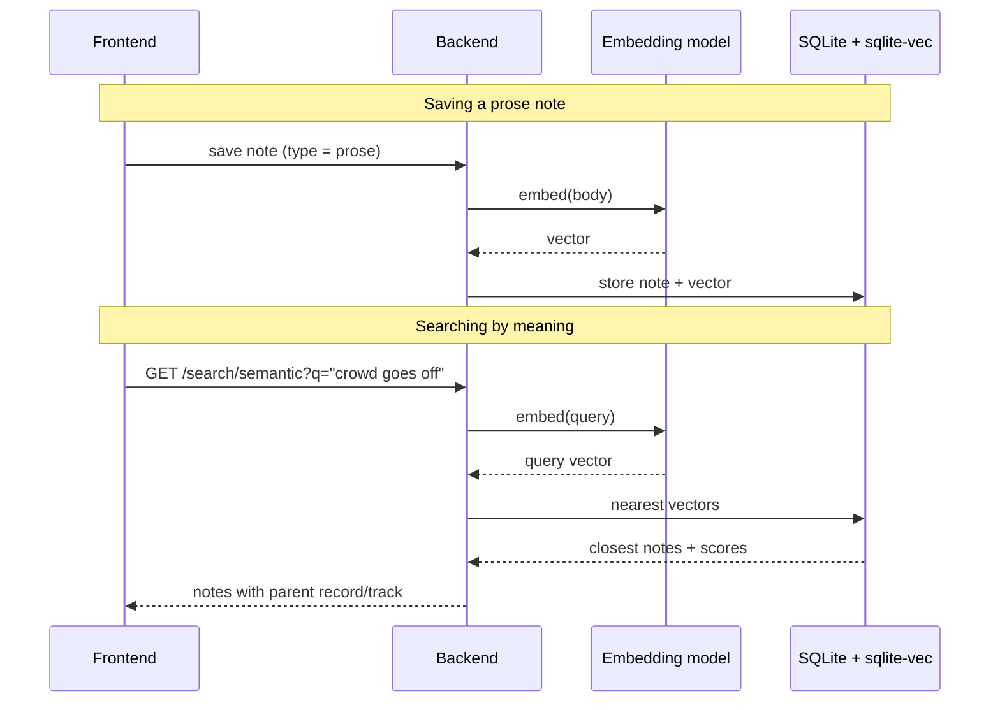
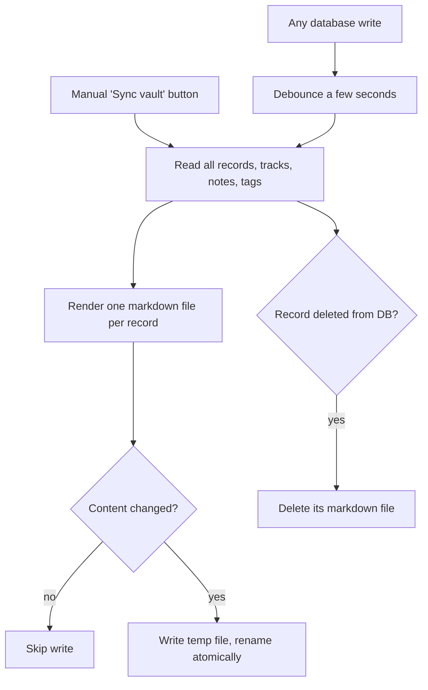
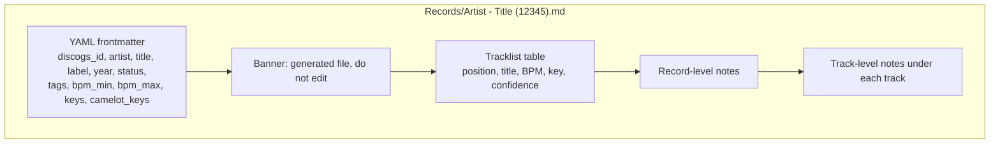
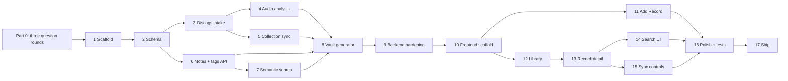
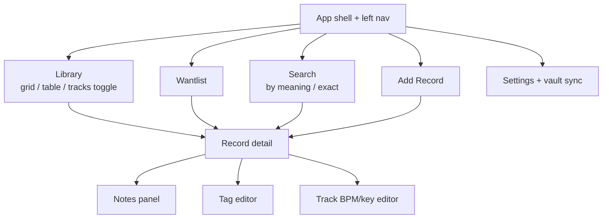

# Vinyl Second-Brain: Complete Guide for Claude Code

> **Claude Code: read this entire file before doing anything.**
> Do NOT write code, create files, or install anything until you have completed **Part 0: Mandatory Question Rounds** and the user has confirmed your summary. This rule overrides any urge to "just start".

## Table of contents

0. Mandatory pre-flight: three question rounds (read first)
1. Project overview and architecture (from the original design document)
2. Diagrams
3. Ground rules
4. Build steps (Part A backend, Part B frontend, Part C shipping)
5. Definition of done and later work

---

# 0. Mandatory pre-flight: three question rounds

Before executing **any** step, you must run **three question rounds in a row**. Each round is one message containing a numbered batch of questions. Wait for the user's answers after each round before sending the next.

## Rules for the rounds

1. **Do not write code, scaffold folders, or run installs** until all three rounds are answered and the user has confirmed your final summary.
2. Ask every question in the round in a **single message**, numbered, so the user can answer by number (`1: yes, 2: local model, 3: ...`).
3. Each question lists a **proposed default** in brackets. If the user answers "default" or skips it, use the default and record that you did.
4. Do not ask what the answer already states. Skip questions this file or the user's earlier answers already settle, but say you skipped them.
5. If an answer opens a new unknown, ask it in the **next** round. After Round 3, you may ask at most one short follow-up message, only for something that blocks the build.
6. After Round 3, write all answers to `docs/decisions.md` (question, answer, whether it was a default). Then post a **summary of the plan as you will build it** and ask: "Confirm to start Step 1?"
7. When a later step contradicts a recorded decision, stop and ask. Do not silently change a decision.

## Round 1: Product, data, and scope (steps 1-5)

Covers: scaffold, schema, Discogs intake, audio analysis, collection write-back.

1. **Audio source.** Discogs gives metadata only, no audio. Where does audio for analysis come from? [Default: you drop files (ripped vinyl or digital) into `audio/<release_id>/` and the app matches them to tracks by position like `A1`.] Options: dropped files, upload through the UI, a streaming preview source, something else.
2. **Audio format and size.** Which formats do you have (WAV, FLAC, MP3, AIFF)? Typical size of one record's files? [Default: WAV/FLAC/MP3, no size limit.]
3. **Filename convention.** How are your files named, if at all? Give two or three real examples. [Default: match by `A1`/`B2` in the filename, then fuzzy title match.]
4. **Analysis engine.** Prefer Essentia (more accurate, harder to install) or librosa (easier, less accurate)? Any existing tool you trust for BPM/key (Mixed In Key, Rekordbox, Traktor)? [Default: Essentia if it installs, else librosa.]
5. **Key display.** Musical keys (`A minor`), Camelot (`8A`), or both? [Default: store both, show Camelot with a toggle.]
6. **Half/double tempo.** Vinyl and DJ tracks often get half or double BPM. Store an alternative value and let you pick? [Default: yes, store `bpm_alt`.]
7. **Manual overrides.** If you correct a BPM or key by hand, should re-analysis ever overwrite it? [Default: never; manual values are protected.]
8. **Discogs account.** Do you have a Discogs personal access token? Which collection folder should new records go to? [Default: folder "Uncategorized" (default folder).]
9. **Discogs links accepted.** Release URLs only, or also master URLs (which need you to pick a pressing)? [Default: release URLs; for master URLs, ask the user to pick a release.]
10. **Duplicates.** If you buy a second copy of the same release, create a second record or reuse the first? [Default: reuse, with a "copies" counter added later if needed.]
11. **Record status.** Should the database hold wantlist / "considering" records too, or only owned ones? [Default: a `status` column (`owned`, `wantlist`, `considering`); only `owned` records are added to your Discogs collection and analyzed automatically.]
12. **Format scope.** Only 12" vinyl, or also 7", LP, CD, digital? [Default: any format, stored as text.]
13. **Multiple users.** Just you, or will others use it? [Default: single user, no login.]
14. **Existing data.** Do you already have a Discogs collection to import, or existing notes or Obsidian files to migrate? [Default: no import in v1; a bulk "import my collection" step noted under Later.]

## Round 2: Technology, search, and Obsidian (steps 6-9)

Covers: notes and tags API, semantic search, Obsidian generator, hardening.

1. **Backend stack.** Python 3.12 + FastAPI + SQLite OK? Any language or framework you'd rather use? [Default: as stated.]
2. **Where it runs.** Your own computer only, a home server, or a cloud host? [Default: your own computer, run with one command.]
3. **Embedding provider.** OpenAI API (simple, small cost) or a local model (free, more setup)? Do you have an OpenAI API key? [Default: OpenAI `text-embedding-3-small` behind a provider interface that a local model can replace.]
4. **Privacy.** Are you comfortable sending note text to an external API? [Default: yes for prose notes only.]
5. **When to embed.** On every save, or on a schedule? [Default: on every save, synchronous.]
6. **Which notes are searchable by meaning.** Only `prose`, or other types too? [Default: `prose` only; structured notes like shelf location stay exact-match.]
7. **Note types.** A small fixed set, or fully open from day one? Which types do you want first? [Default: open text field; UI suggests `prose`, `cue-points`, `location`, `purchase`, `condition`.]
8. **Cue points.** Free text like "drop at 1:32", or structured (time + label)? [Default: free text in v1.]
9. **Tags.** Freeform, or a controlled list from Discogs genres and styles? Should tags apply to records, tracks, or both? [Default: freeform with autocomplete seeded from Discogs genres/styles; both records and tracks.]
10. **Tag case and format.** Lowercase and trimmed automatically? Allow spaces and hierarchies (`energy/peak`)? [Default: lowercase, trimmed, spaces allowed, no hierarchy.]
11. **Obsidian vault.** Do you already have a vault? Full path? Should generated files go in a subfolder of it (e.g. `Vinyl/`) or a separate vault? [Default: separate `vault/` folder you open or symlink into Obsidian.]
12. **Obsidian note body.** Fully regenerated from the database on every sync (hand-edits discarded), or allow a protected hand-written section? [Default: fully regenerated.]
13. **Obsidian filename format.** `Artist - Title (release_id).md` OK? [Default: yes.]
14. **Obsidian plugins.** Dataview only, or also Smart Connections? [Default: Dataview only; semantic search lives in this app.]
15. **Sync trigger.** After every database write (debounced), on a button, or on a schedule? [Default: debounced after writes plus a manual button.]
16. **Backups.** How often, and where? [Default: nightly copy of the SQLite file to a `backups/` folder, keep 14.]
17. **Data you must never lose.** Is the database the source of truth even if Obsidian files get deleted? [Default: yes, vault can always be regenerated.]

## Round 3: Frontend, UX, quality, and delivery (steps 10-17)

Covers: frontend scaffold, add-record flow, library, detail page, search UI, sync controls, polish, shipping.

1. **Frontend stack.** React + Vite + TypeScript + TanStack Query + Tailwind OK? [Default: as stated.]
2. **Devices.** Desktop only, or also phone and tablet (e.g. in a record shop)? [Default: desktop first, usable on tablet; mobile later.]
3. **Look and feel.** Dark or light? Any reference apps or sites you like (Discogs, Rekordbox, Spotify, Notion)? [Default: dark theme, dense and calm, cover-art grid.]
4. **Main screen.** Cover-art grid, dense table, or both with a toggle? [Default: both; grid by default.]
5. **Track-level browsing.** Do you want to browse a flat list of tracks across all records (for DJ set prep)? [Default: yes, via a "Tracks" toggle in the library.]
6. **Filters you need most.** Rank: BPM range, key, tag, label, year, genre, status, text. [Default: BPM, key, tag, status, text; add label/year/genre later.]
7. **Harmonic mixing.** Want a "compatible keys" helper (Camelot neighbors) on the track list? [Default: not in v1; listed under Later.]
8. **Add-record flow.** After pasting a link, should analysis start automatically, or wait for a button? [Default: automatic if audio files exist.]
9. **Error handling.** When analysis or Discogs sync fails, show a retry button, or retry automatically? [Default: show status chips with a retry button.]
10. **Cover art.** Use Discogs image URLs directly, or download and store them locally? [Default: download and cache locally.]
11. **Keyboard shortcuts.** Want them (`/` for search, `n` for new record)? [Default: yes.]
12. **Language.** UI in English only? [Default: English.]
13. **Testing level.** Unit tests only, or also end-to-end browser tests? [Default: backend unit/integration tests, frontend component tests, one Playwright end-to-end test.]
14. **Packaging.** Docker Compose, or a plain `make run`? Which OS do you use? [Default: `make run` plus an optional Docker Compose file.]
15. **Version control.** Git repo already created? Remote on GitHub? Commit after every step? [Default: yes, one commit per step with a clear message.]
16. **Pace.** Should I stop and wait for your approval after each step, or run several steps and report? [Default: stop after each step.]
17. **Anything else.** Features, constraints, or things you definitely do **not** want? [No default; the user answers freely.]

## After the rounds

- Write `docs/decisions.md`.
- Post your plan summary: stack, folder layout, step order, and any step you changed because of the answers.
- Ask: "Confirm to start Step 1?" and **wait**.

---

# 1. Project overview and architecture

*(Reproduced from the original design document, "Vinyl Second-Brain Architecture", Oct 10, 2026.)*

A system that takes a newly bought record from a Discogs link, analyzes every track for BPM and key, stores it all in a queryable database, and projects it into Obsidian as a read-mostly second brain for notes, tags, and discovery.

## Overview

One event, two branches. The Discogs link triggers analysis once; after that, Discogs collection and the database are written independently, and only the database ever gets edited. Obsidian and its markdown files are generated output, not a second place to write. (See diagram 2.1.)

## Data model

Four entities: records, tracks under them, notes attached to either, and tags. Notes are deliberately one flexible table rather than several, since new note types will keep showing up.

| Entity | Key fields | Notes |
| --- | --- | --- |
| Record | Discogs release ID, artist, title, label, year, format | One row per release; mirrors the Discogs collection entry |
| Track | Position (e.g. A1), title, BPM, key, duration, confidence score | Child of a record; holds the analysis tool's raw output |
| Note | Type, body text, embedding vector, timestamp, parent (record or track) | Type is an open tag, not a fixed enum: prose, cue-points, shelf location, purchase info, condition, anything new |
| Tag | Name, parent (record or track) | Many-to-many; freeform or controlled vocabulary, your choice |

Two design choices worth flagging. First, notes attach to either a record or a track, since some things are release-level (where you bought it) and some are track-level (cue points, a DJ note on one song). Second, only the `prose`-type notes get embedded for semantic search; structured notes like shelf location stay exact-match fields, there's no meaning to search for in a shelf number.

## Role split: database vs. Obsidian

The database is the single place where writing happens. Obsidian is a generated, read-mostly view on top of it. This avoids two-way sync between markdown files and a database, which is the hardest part to get right in this kind of system.

|  | Database (your app) | Obsidian |
| --- | --- | --- |
| Owns | All structured fields and all note text | Nothing; it only displays |
| Editing | Yes, this is where you write | Read-only in principle; treat edits there as disposable |
| Query style | Exact filters: BPM range, key, tag, full-text | Dataview syntax over frontmatter; good for browsing, not precision |
| Can hold | Only records you own or have analyzed | Also wantlist items, records you don't own, speculative notes |
| Regeneration | N/A | One markdown file per record, rewritten whenever the database changes |

The rule that keeps this simple: your sync script only ever overwrites the frontmatter block of a generated note, never the body. In practice this works best if the body is treated as pure display too, for example rendered from the database's note text into the markdown body on every regen, rather than hand-edited in Obsidian at all. If you want Obsidian itself to be writable someday, that's a bigger step (true two-way sync) and worth treating as a separate, later decision rather than building it in now.

## Semantic search over notes

Dataview and ordinary full-text search only match literal words, so "banging track" and "huge energy, crowd goes off" look unrelated to them even though they mean the same thing. Meaning-based search needs embeddings, which is a separate, small pipeline:

1. Whenever a prose note is saved, send its text to an embedding model (OpenAI's API is simplest; a local open-source model works too and is free).
2. Store the resulting vector alongside the note in the database. With SQLite, the `sqlite-vec` extension makes this a single extra column.
3. To search, embed the query the same way and ask the database for the closest stored vectors, one function call does the similarity math.

Realistically 50 to 100 lines of code, most of it plumbing. The only real design question is when to (re-)run the embedding: on every save, or on a schedule. This lives entirely in the database layer; Obsidian never needs to know it exists, though a search box in the app can jump straight to the matching record's note.

## Open decisions (resolved in Round 1-3 of Part 0)

| Original open decision | Answered by |
| --- | --- |
| Note types: small fixed set or fully open? | Round 2, Q7 |
| Obsidian body: fully auto-rendered or light hand-editing? | Round 2, Q12 |
| Embedding provider: OpenAI or local? | Round 2, Q3 |
| Tag vocabulary: freeform or controlled? | Round 2, Q9 |
| Obsidian plugins: Dataview only or also Smart Connections? | Round 2, Q14 |
| Non-owned records: own flag in DB or Obsidian only? | Round 1, Q11 |

---

# 2. Diagrams

All diagrams use Mermaid. They render on GitHub and in Obsidian (Mermaid code blocks).

## 2.1 End-to-end pipeline (one event, two branches)

The analysis job and the Discogs collection job are independent. If one fails, the other still succeeds, and either can be retried alone.

## 2.2 Data model

A note has **exactly one** parent: either a record or a track. Only notes with `type = prose` get a row in `NOTE_EMBEDDING`.

## 2.3 Role split: database vs. Obsidian

There is deliberately **no arrow from Obsidian back to the database**.

## 2.4 Intake sequence

## 2.5 Semantic search

## 2.6 Vault regeneration

## 2.7 Generated note layout

## 2.8 Step dependency graph

## 2.9 Frontend page map

---

# 3. Ground rules

These apply to every step. Put them in `CLAUDE.md` after Part 0.

- The database is the **only** place anything is written. Obsidian markdown is generated output, overwritten on every sync. Never build two-way sync.
- Use the stack confirmed in Part 0 (proposed: Python 3.12, FastAPI, SQLite + `sqlite-vec`, pytest; React + Vite + TypeScript).
- Monorepo layout: `backend/`, `frontend/`, `vault/` (generated), `audio/` (git-ignored), `docs/`.
- One step at a time. Finish its **Done when** checks, write a note to `docs/progress.md`, commit, then follow the pace chosen in Round 3, Q16.
- Secrets live in `.env`, never committed. Maintain `.env.example`.
- If a step needs a decision not in `docs/decisions.md`, stop and ask. Do not guess.
- Never overwrite a manual BPM/key edit during re-analysis (unless Round 1, Q7 says otherwise).
- Never silently skip or guess a file-to-track match; report it.

---

# 4. Build steps

## Part A: Backend

### Step 1: Project scaffold
**Goal:** empty but runnable monorepo.
1. Create the layout, root `README.md`, `.gitignore` (`.env`, `audio/`, `*.db`, `node_modules`, `vault/`), and `.env.example` (`DISCOGS_TOKEN`, `OPENAI_API_KEY`, `DB_PATH`, `AUDIO_DIR`, `VAULT_DIR`).
2. In `backend/`: `pyproject.toml`, a FastAPI app with `GET /health`, pytest with one passing test.
3. A `Makefile` with `dev`, `test`, `lint`.

**Done when:** `make test` passes and `/health` returns `{"status":"ok"}`.

### Step 2: Database schema and migrations
**Goal:** the four entities, with vector support. (Diagram 2.2.)
1. SQLite with `sqlite-vec` loaded on connect. Numbered `.sql` migrations plus a `schema_version` table.
2. Tables: `records` (with `status`, `cover_url`, `discogs_collection_synced`), `tracks` (with `bpm`, `key`, `camelot_key`, `confidence`, `analysis_raw`, `audio_path`, `manual_override`), `notes` (CHECK: exactly one of `record_id` / `track_id`), `note_embeddings` (`sqlite-vec` virtual table, prose notes only), `tags` plus `record_tags` and `track_tags`.
3. FTS5 table over note bodies and record artist/title/label.
4. A data-access layer in `backend/app/db/`; no business logic in route handlers.

**Done when:** tests create records, tracks, record-level and track-level notes, and tags, and the one-parent constraint rejects bad notes.

### Step 3: Discogs client and record intake (metadata only)
**Goal:** a pasted link becomes a record plus tracklist. (Diagram 2.4.)
1. `discogs.py`: parse URL to release ID, fetch via the API with the token, retry with backoff on 429.
2. Map to Record and Track rows; handle positions like `A1`, `B2`, `C1`; skip heading rows.
3. `POST /api/records/intake` with `{ "discogs_url": "..." }`. If the release already exists, return it with HTTP 200 instead of duplicating.
4. Tests use saved JSON fixtures of 2-3 real responses.

**Done when:** a real link creates one record and the right number of tracks; posting twice does not duplicate.

### Step 4: Audio analysis (BPM and key)
**Goal:** fill BPM, key, confidence per track.
1. `analysis/` module with one interface: `analyze(path) -> {bpm, key, camelot_key, confidence, raw}`; engine chosen in Round 1, Q4, kept swappable.
2. Camelot conversion helper with unit tests.
3. Matching: files to tracks by position in the filename, then fuzzy title. Return a **match report** of unmatched files and tracks. Never guess silently.
4. Background jobs (`jobs` table: id, type, status, error, created_at). Endpoints: `POST /api/records/{id}/analyze`, `GET /api/jobs/{id}`.
5. Store raw output in `analysis_raw`, plus `bpm_alt` (half/double) per Round 1, Q6.

**Done when:** a folder of 2-3 short test files fills the right tracks; a mismatched filename appears in the match report.

### Step 5: Discogs collection write-back
**Goal:** the record also lands in your Discogs collection, independently of analysis.
1. `add_to_collection(release_id)` in the Discogs client, using the folder from Round 1, Q8.
2. A separate job from analysis; success sets `discogs_collection_synced`, failure stores the error.
3. Intake enqueues both jobs independently. `POST /api/records/{id}/sync-discogs` retries manually.
4. Only `owned` records are added to the collection.

**Done when:** success marks the record synced; a simulated Discogs failure leaves analysis unaffected and is retryable.

### Step 6: Notes and tags API
**Goal:** full CRUD for everything the frontend edits.
1. Records: `GET /api/records`, `GET/PATCH/DELETE /api/records/{id}`. Tracks: `PATCH /api/tracks/{id}` (manual override, flagged). Notes: `POST/PATCH/DELETE /api/notes` (one parent). Tags: `GET /api/tags` (with counts), add/remove on records and tracks.
2. Filters on `GET /api/records`: `bpm_min`, `bpm_max`, `key` (musical or Camelot), `tag` (repeatable), `status`, `q`, plus pagination. A record matches if **any** track matches, and the response says which tracks.
3. `GET /api/tracks` with the same filters (track-level browsing).
4. Pydantic validation and one consistent error format.

**Done when:** tests cover every endpoint and filter combination, including both note levels.

### Step 7: Semantic search
**Goal:** "crowd goes off" finds "banging track". (Diagram 2.5.)
1. `embeddings/` with a provider interface `embed(texts) -> vectors`; the OpenAI implementation (or local, per Round 2, Q3) and a deterministic fake for tests.
2. Embed only `prose` notes; re-embed on edit; delete the embedding on note delete or when type leaves `prose`. Isolate in one function so it can move to a queue.
3. `GET /api/search/semantic?q=&limit=` returns notes with parent and similarity score.
4. `POST /api/admin/reembed` rebuilds all embeddings.

**Done when:** tests prove embed-on-save, re-embed-on-edit, cleanup-on-delete; a manual synonym query finds the right note.

### Step 8: Obsidian vault generator
**Goal:** one generated markdown file per record. (Diagrams 2.3, 2.6, 2.7.)
1. `sync_vault.py`, also a CLI command and `POST /api/admin/sync-vault`; files at `vault/Records/<Artist> - <Title> (<release_id>).md`.
2. Each file is fully regenerated: frontmatter (`discogs_id`, `artist`, `title`, `label`, `year`, `format`, `status`, `tags`, `bpm_min`, `bpm_max`, `keys`, `camelot_keys`), a "generated, do not edit" banner, tracklist table, record notes, track notes under their track.
3. Delete files of removed records; write atomically; skip unchanged files.
4. Wantlist/considering records get files with `status` in frontmatter.
5. Debounced sync after DB writes plus the manual endpoint.
6. Generate `vault/Dataview Examples.md` with 3-4 queries (BPM range, key, tag).

**Done when:** a snapshot test matches the markdown for a fixture record, and the Dataview examples work in Obsidian.

### Step 9: Backend hardening
1. Structured logging, global exception handler, CORS for the frontend origin.
2. Confirm `/docs` shows every endpoint accurately; export `docs/openapi.json`.
3. Backup command (timestamped SQLite copy) per Round 2, Q16.
4. Run the full suite, fix flakiness, report coverage.

**Done when:** all tests pass and `docs/openapi.json` exists.

## Part B: Frontend

### Step 10: Frontend scaffold
1. Vite + React + TypeScript, React Router, TanStack Query, styling approach from Round 3.
2. Typed API client generated from `docs/openapi.json`, wrapped in `api.ts`.
3. App shell with left nav (Library, Wantlist, Search, Add Record, Settings) per diagram 2.9; theme from Round 3, Q3.
4. Dev proxy to the backend.

**Done when:** `npm run dev` shows the shell and a health indicator reading `/health`.

### Step 11: Add Record flow
1. A page with a Discogs URL input, a status selector, and a submit button.
2. After submit: the created record and tracklist, with **Analysis** and **Discogs sync** status chips polling `/api/jobs/{id}`, each with retry.
3. Show the match report; allow manual file-to-track assignment.
4. Duplicates: "already in your library" with a link.

**Done when:** pasting a link works end to end, with failures visible and retryable.

### Step 12: Library view with filters
1. Cover grid with a toggle to a dense table.
2. Filter bar: BPM range slider, key picker (musical/Camelot toggle), tag multi-select with counts, status, text search. Filters live in the URL.
3. A "Tracks" toggle using `GET /api/tracks`.
4. Pagination or infinite scroll; loading and empty states.

**Done when:** every filter works alone and combined; back button restores filter state.

### Step 13: Record detail and editing
1. Header (cover, metadata, status, Discogs link); tracklist with BPM, key, confidence (flag low confidence, show alt BPM).
2. Inline manual override of BPM/key, clearly marked manual.
3. Notes panel: grouped by type, add/edit/delete, type suggestions, markdown body, attach to record or a chosen track.
4. Tag editor with autocomplete for records and tracks.
5. Autosave with a saved/saving indicator and optimistic updates.

**Done when:** you can add a prose note on a track, a location note on the record, hand-edit a BPM, and everything persists after reload.

### Step 14: Semantic search UI
1. One box, two modes: **By meaning** (default) and **Exact**.
2. Results show the note snippet, parent record/track, similarity; click opens the record scrolled to the note.
3. Debounce input; cancel stale requests.

**Done when:** "crowd goes crazy" surfaces a note saying "huge energy, floor erupted".

### Step 15: Obsidian sync controls
1. Settings page: vault path (display only), "Sync vault now", last sync time, files written/skipped/deleted.
2. Plain-language warning that Obsidian edits are overwritten.

**Done when:** clicking Sync updates the vault and the UI reports the result.

### Step 16: Polish, errors, and tests
1. Error boundary, toasts, skeleton loaders.
2. Shortcuts (`/` search, `n` add record) if confirmed in Round 3, Q11.
3. Accessibility pass.
4. Vitest tests for the filter bar and note editor; one Playwright test: add record (mocked Discogs) → add note → search it → confirm it in the vault file.

**Done when:** the Playwright test passes.

## Part C: Shipping

### Step 17: Run it for real
1. `make run` (and optionally `docker-compose.yml`) starting backend and built frontend, with volumes for DB, `audio/`, `vault/`.
2. README: setup, getting a Discogs token, where to drop audio, how to point Obsidian at `vault/`, the backup command.
3. Nightly backup.

**Done when:** a fresh clone plus `.env` gives a working app with one command.

---

# 5. Definition of done and later work

**The project is done when:**
- Pasting a Discogs link produces a record, an analyzed tracklist, and a Discogs collection entry, with failures isolated and retryable.
- Notes and tags can be written only through the app, and the vault regenerates from the database.
- Searching by meaning finds notes that share no words with the query.
- Deleting the vault and re-syncing recreates it exactly.

**Later (do not build now):**
- True two-way Obsidian sync (separate, harder decision)
- Local embedding model option
- Smart Connections plugin comparison
- Bulk import of an existing Discogs collection
- Harmonic-mixing helper (compatible Camelot keys) and set-building views
- Mobile layout for record shops
